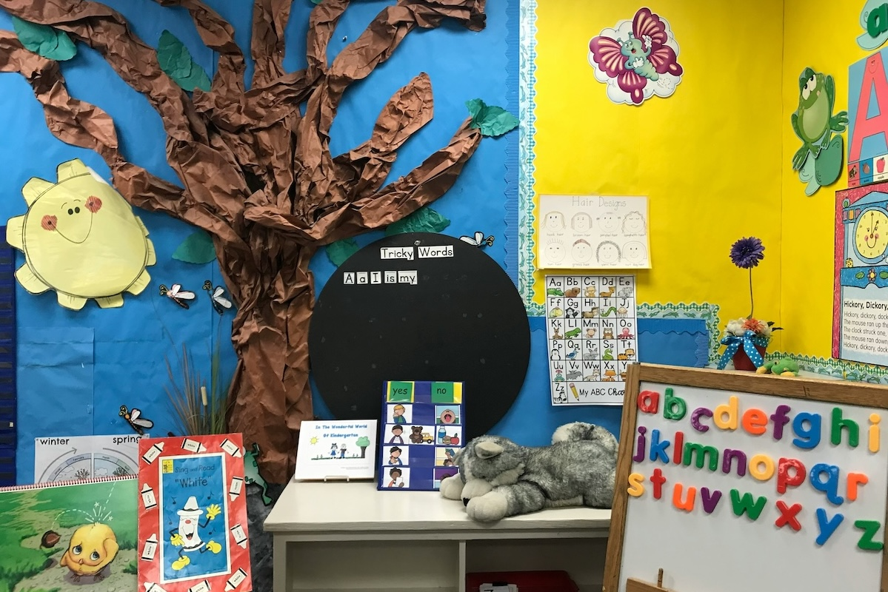
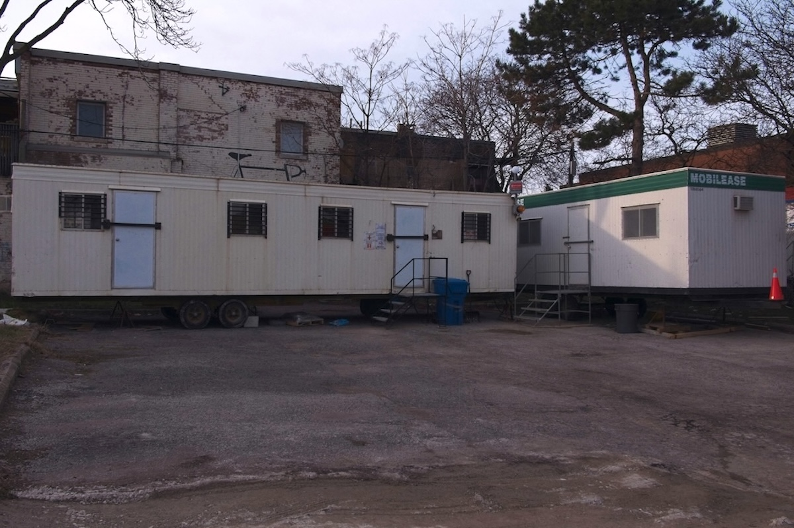
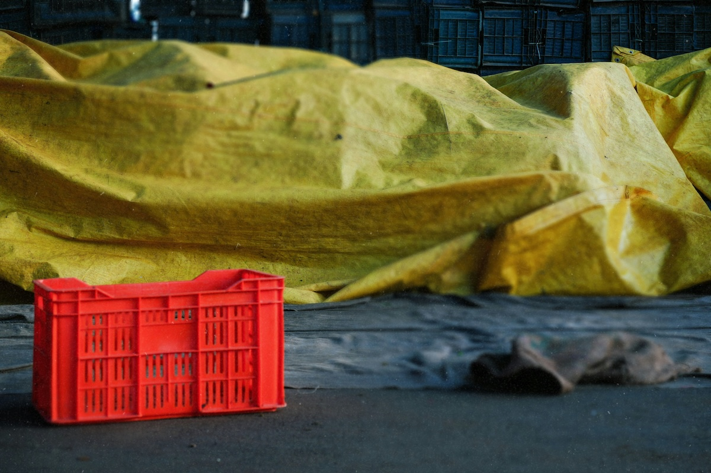
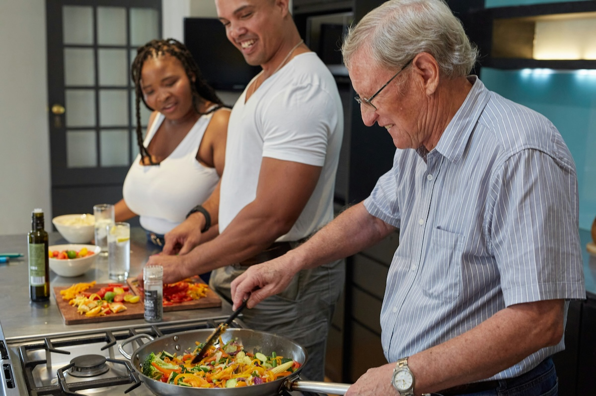
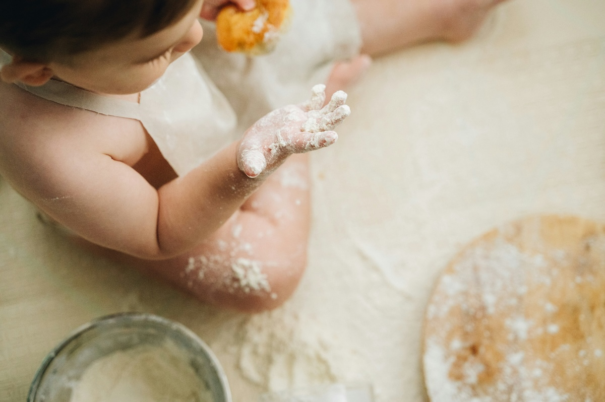
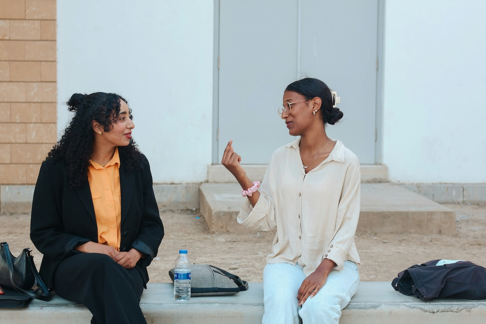
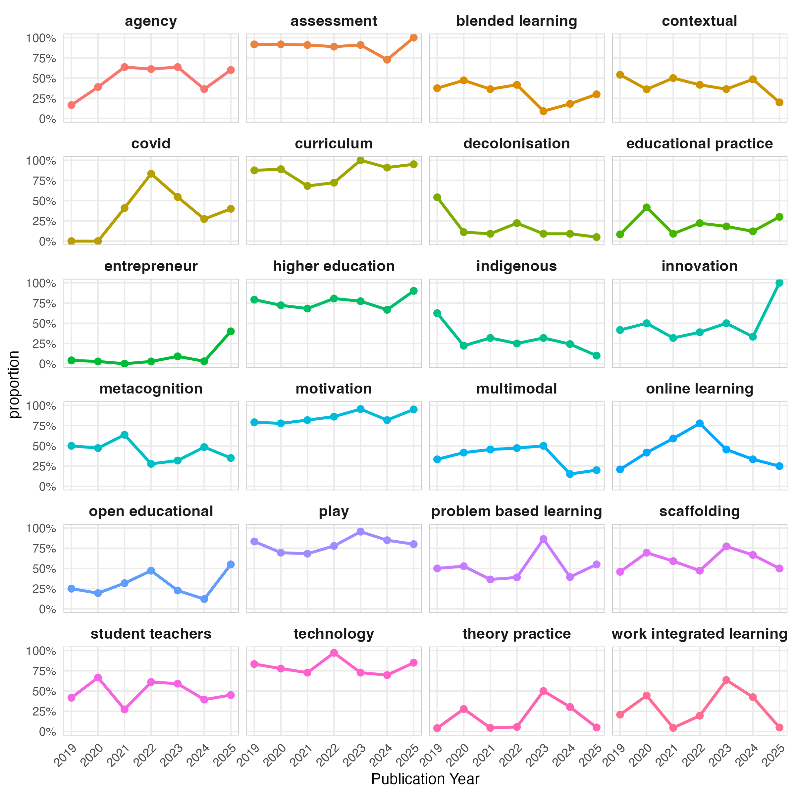

```{r setup, include=FALSE}
usethis::use_git_ignore(c("*.csv", "*.rds"))
options(htmltools.dir.version = FALSE)

library(knitr)
library(tidyverse)
library(xaringan)
library(fontawesome)
```

class: inverse, center, middle

# `r fa("fas fa-images", fill = "#fff")`

**View the slides:** 

[bretsw.com/sdl26-nwu](https://bretsw.com/sdl26-nwu/)


---

class: inverse, center, middle

# `r fa("far fa-comment", fill = "#fff")` <br><br> Hello!


---

class: inverse, center, middle

# `r fa("fas fa-quote-left", fill = "#fff")` Human actions are always dialectical unities of outside and inside: we guide our actions with the help of external cultural artifacts

~ Yrjö Engeström (yesterday)

--

<hr>

**We understand these dialectical unities through stories.**

--

(And I love that Yrjö ended his keynote with a story about homelessness)


---

class: inverse, center, middle

# `r fa("far fa-comment", fill = "#fff")` <br><br> Introduction Story

---

# `r fa("fas fa-person-chalkboard", fill = "#fff")` Teachers' Prof. Learning

```{r, out.width = "100%", echo = FALSE, fig.align = "center"}

```

---

# My Usual Research Methods

.pull-left[

### Digital Traces

```{r, out.width = "100%", echo = FALSE, fig.align = "center"}

```

]

.pull-right[

### Interviews

```{r, out.width = "100%", echo = FALSE, fig.align = "center"}

```

]

--

**Teachers were intentional in their learning, but why? How?**

---

# `r fa("fas fa-person-chalkboard", fill = "#fff")` Anne

.pull-left[

### Expectations

```{r, out.width = "100%", echo = FALSE, fig.align = "center"}

```

]

--

.pull-right[

### Reality

```{r, out.width = "100%", echo = FALSE, fig.align = "center"}

```

]

---

# `r fa("fas fa-person-chalkboard", fill = "#fff")` Amelia

.pull-left[

### Expectations

```{r, out.width = "100%", echo = FALSE, fig.align = "center"}

```

]

--

.pull-right[

### Reality

```{r, out.width = "100%", echo = FALSE, fig.align = "center"}

```

]


---

class: inverse, center, middle

# `r fa("fas fa-quote-left", fill = "#fff")` Knowles' Definition of SDL

--

“In its broadest meaning, ‘self-directed learning’ describes a process in which individuals take the initiative, with or without the help of others, in diagnosing their learning needs, formulating their learning goals, identifying human and material resources for learning, choosing and implementing appropriate learning strategies, and evaluating learning outcomes.” (Knowles, 1975, p. 18)

Knowles, M. S. (1975). *Self-directed learning: A guide for learners and teachers*. Cambridge, The Adult Education Company.

---

# `r fa("fas fa-mountain-sun", fill = "#fff")` SDL Activities

```{r, out.width = "35%", echo = FALSE, fig.align = "center"}

```

--

1. Diagnosing their learning needs

--

2. Formulating their learning goals

--

3. Identifying human and material resources for learning

--

4. Choosing and implementing appropriate learning strategies

--

5. Evaluating learning outcome

--

<hr>

**How did SDL help me make sense of Anne and Amelia's stories?**

--

**AND: How do Anne and Amelia's stories bring these SDL activities to life?**


---

class: inverse, center, middle

# `r fa("far fa-comment-dots", fill = "#fff")` <br><br> What's Your _Introduction_ Story?

--

**Problem:** Challenge | Opportunity

**Plot:** Who + What + How + When + Where + Why


---

class: inverse, center, middle

# `r fa("far fa-comment", fill = "#fff")` <br><br> _Before_ Story


---

# `r fa("fas fa-bowl-rice", fill = "#fff")` Cooking

.pull-left[

### Expectations

```{r, out.width = "100%", echo = FALSE, fig.align = "center"}

```

]

--

.pull-right[

### Reality

```{r, out.width = "100%", echo = FALSE, fig.align = "center"}

```

]

---

# `r fa("fas fa-mountain-sun", fill = "#fff")` SDL + Story

.pull-left[

### How would my cooking story have been improved with SDL?

```{r, out.width = "100%", echo = FALSE, fig.align = "center"}

```

]

--

.pull-right[

### How does my cooking story bring these SDL activities to life?

1. Diagnosing their learning needs

2. Formulating their learning goals

3. Identifying human and material resources for learning

4. Choosing and implementing appropriate learning strategies

5. Evaluating learning outcome

]


---

class: inverse, center, middle

# `r fa("far fa-comment-dots", fill = "#fff")` <br><br> What's Your _Before_ Story?

**Problem:** Challenge | Opportunity

**Plot:** Who + What + How + When + Where + Why


---

class: inverse, center, middle

# `r fa("far fa-comment", fill = "#fff")` <br><br> After Story


---

# `r fa("fas fa-code", fill = "#fff")` Web Development

.pull-left[

### Expectations

```{r, out.width = "100%", echo = FALSE, fig.align = "center"}

```

]

--

.pull-right[

### Reality

```{r, out.width = "100%", echo = FALSE, fig.align = "center"}

```

]


---

# `r fa("fas fa-mountain-sun", fill = "#fff")` SDL + Story

.pull-left[

### How can my web development story continue to be improved with SDL?

```{r, out.width = "100%", echo = FALSE, fig.align = "center"}

```

]

--

.pull-right[

### How does my web development story bring these SDL activities to life?

1. Diagnosing their learning needs

2. Formulating their learning goals

3. Identifying human and material resources for learning

4. Choosing and implementing appropriate learning strategies

5. Evaluating learning outcome

]


---

class: inverse, center, middle

# `r fa("far fa-comment-dots", fill = "#fff")` <br><br> What's Your _After_ Story?

**Problem:** Challenge | Opportunity

**Plot:** Who + What + How + When + Where + Why


---

class: inverse, center, middle

# `r fa("fas fa-forward", fill = "#fff")` <br><br> Further Reflection

---

# `r fa("fas fa-forward", fill = "#fff")` Why me + SDL?

```{r, out.width = "80%", echo = FALSE, fig.align = "center"}

```

### What does this all mean? Why me?

--

**Listening is my super power (I have lots of stories about why), and this seems to have prepared me for SDL...**

---

# `r fa("fas fa-forward", fill = "#fff")` Why you + SDL?

```{r, out.width = "80%", echo = FALSE, fig.align = "center"}

```

### Why you? Why NWU? Why South Africa?

---

# `r fa("fas fa-forward", fill = "#fff")` What's next?

.pull-left-70[

```{r, out.width = "100%", echo = FALSE, fig.align = "center"}

```

]

--

.pull-right-30[

### What are the stories behind these trends in the AOSIS SDL book series?

]


---

class: inverse, center, middle

# `r fa("fas fa-comment-dots", fill = "#fff")` <br><br> Final Thought:<br><br>Stories and SDL

**How might stories unlock better SDL in an age of accelerating change?**

(processes for both wicked challenges and mundane improvements)


---

class: inverse, center, middle

# `r fa("fas fa-question", fill = "#fff")` <br><br> What should we<br>talk more about?

<hr>

<br><br><br><br><br>

**Bret Staudt Willet** <br><br> Florida State University (USA)

`r fa("envelope", fill = "#fff")` [bret.staudtwillet@fsu.edu](mailto:bret.staudtwillet@fsu.edu) | `r fa("globe", fill = "#fff")` [bretsw.com](https://bretsw.com/) | `r fa("fab fa-github", fill = "#fff")` [github.com/bretsw](https://github.com/bretsw/)